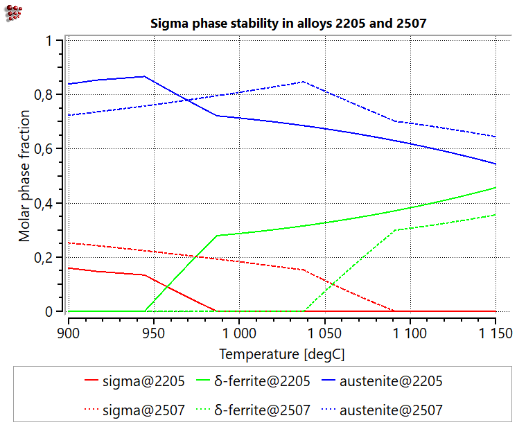
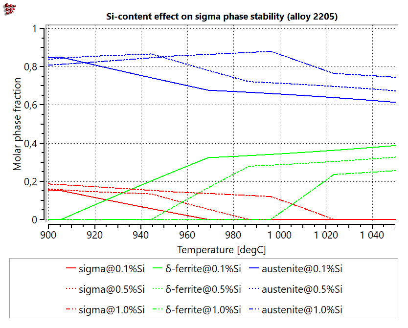

# At What Temperature Does Sigma Phase Become Stable in Duplex Stainless Steel?

## 1 · Problem — Engineering Context

Duplex stainless steels such as 2205 and the higher-alloyed super duplex grade 2507 are susceptible to the formation of the intermetallic sigma phase, a chromium- and molybdenum-rich constituent that substantially reduces toughness and corrosion resistance. Sigma-phase formation is a recognized risk during welding, hot forming, and improper solution annealing. Before process parameters can be specified with confidence, two questions must be answered: over what temperature range is sigma phase thermodynamically stable for a given grade, and how does this range shift when moving from a standard duplex grade to a higher-alloyed super duplex composition?

A further, practically relevant complication arises from heat-to-heat variation: commercial mill heats vary within the permitted specification, particularly with respect to minor elements such as silicon. Whether this variation is significant enough to influence sigma-phase risk, or negligible in comparison to the grade-level effect, is not immediately evident from standard reference data.

## 2 · Approach — Thermodynamic Calculation

The phase equilibria of each alloy were calculated as a function of temperature using the full, realistic commercial composition (Cr, Ni, Mo, N, together with Mn, Si, and trace P, S, and C), rather than a reduced representation limited to the primary alloying elements. The sigma-phase solvus temperature — the temperature above which sigma fully dissolves into the austenite/ferrite matrix — was extracted for each condition. Two comparisons were carried out: first, between the 2205 and 2507 grades at fixed nominal composition; second, across a range of silicon content within the 2205 specification, to quantify the sensitivity of the solvus temperature to a single minor element.

As with any equilibrium calculation, the result identifies the temperature range in which sigma phase is thermodynamically favored; it does not by itself indicate the rate at which sigma will form or dissolve under the finite-time heating and cooling conditions of an actual process. This kinetic aspect is addressed separately in Part 2 of this use case.

## 3 · Evidence

### Aspect 1 — Grade Comparison: 2205 vs. 2507

*Figure 1. Calculated molar phase fractions of sigma, δ-ferrite, and austenite as a function of temperature for 2205 and 2507, full commercial composition.*

| Grade | Composition | Sigma-phase solvus temperature |
|:---:|:---:|:---:|
| 2205 | Fe-22Cr-5.5Ni-3Mo-0.14N + 1% Mn, 0.5% Si, 0.015% P, 0.015% C, 0.01% S | 987 °C |
| 2507 | Fe-25Cr-7Ni-4Mo-0.3N + 0.6% Mn, 0.4% Si, 0.0175% P, 0.01% S, 0.015% C | 1091 °C |

The calculation indicates a substantial shift in sigma-phase solvus temperature between the two grades, with 2507 exhibiting a solvus approximately 100 °C higher than 2205. This is consistent with the higher chromium and molybdenum content of the super duplex grade, the same alloying elements responsible for its superior corrosion resistance. The result illustrates a direct metallurgical trade-off: improved corrosion performance in 2507 is accompanied by a wider temperature interval over which sigma phase can persist or re-form, a factor that must be accounted for when specifying solution-annealing or post-weld heat-treatment parameters for the higher-alloyed grade.

### Aspect 2 — Sensitivity to Silicon Content Within the 2205 Specification

*Figure 2. Effect of silicon content (0.1, 0.5, and 1.0 wt.%) on calculated phase stability in alloy 2205, full commercial composition.*

| Si content (2205, full composition) | Sigma-phase solvus temperature |
|:---:|:---:|
| 0.1 % | 969 °C |
| 0.5 % | 987 °C |
| 1.0 % | 1023 °C |

The calculated sensitivity to silicon content is pronounced: increasing Si from 0.1 to 1.0 wt.% — both values within the standard 2205 specification (typically ≤1 wt.% Si) — raises the sigma-phase solvus temperature by 54 °C, a shift corresponding to more than half of the difference observed between the 2205 and 2507 grades. This indicates that two mill heats of nominally identical grade, differing only in where their silicon content falls within the permitted specification range, may exhibit meaningfully different sigma-phase risk ranges. The same qualitative sensitivity to silicon is expected in 2507 and other duplex grades, as the underlying mechanism — silicon acting as a sigma-phase stabilizer — is not specific to 2205.

### Practical Takeaway

Both the choice of alloy grade and the exact heat composition within that grade's specification materially affect the sigma-phase risk range. A single representative value quoted for a nominal grade composition may understate the compositional spread encountered across actual mill certificates, with direct implications for the specification of solution-annealing and post-weld heat-treatment temperatures.

